<!-- Three-part terminal-inspired profile. Preview only: main README remains unchanged. -->

<a href="https://github.com/Yuvaraj-Dey-2006">github</a> &nbsp;/&nbsp; <a href="https://www.linkedin.com/in/yuvaraj-dey-851044330/">linkedin</a> &nbsp;/&nbsp; <a href="mailto:yuvarajdey1234@gmail.com">email</a>

